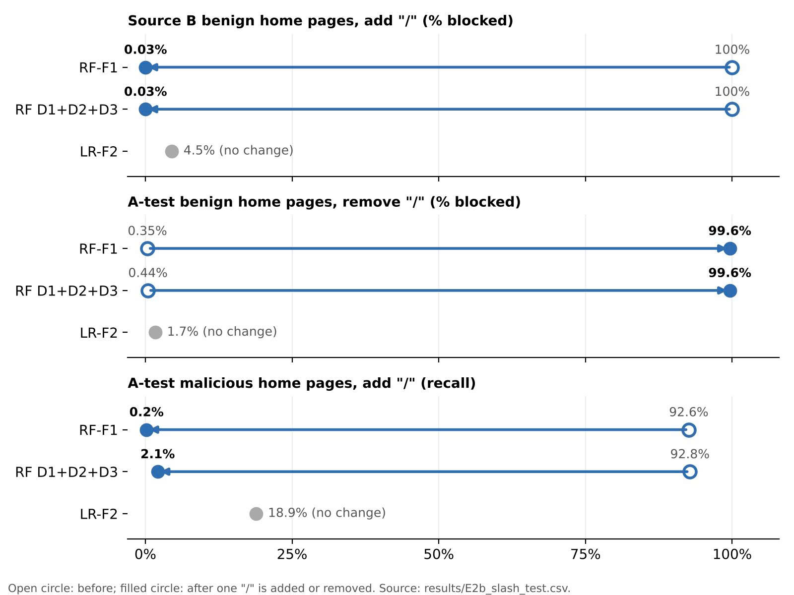
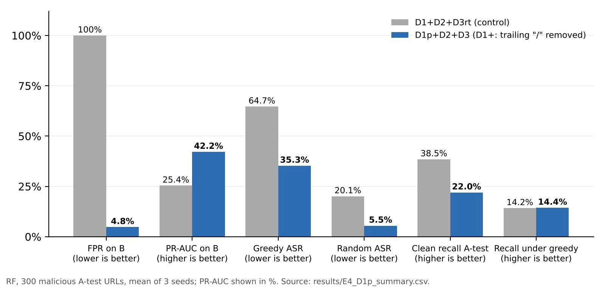

# AIC211 Topic 2 – Robust Beyond the Benchmark

Cross-source and adversarial evaluation of lexical malicious URL detectors.

Course: AIC211 – AI for Cybersecurity · Team: Nhóm Trí · Status: final for submission (30 Oct 2026); result numbers come from the 24 Oct 2026 freeze and the separate result files listed below

---

## Overview

Many papers report >90% accuracy for malicious URL detectors on one benchmark. This project does **not** try to beat that number. It asks:

> How much of the benchmark score survives (a) data from a different source and (b) an attacker who edits the URL on purpose, and which cheap defense wins back the most?

All detectors use the **URL string only**. No page is ever opened, fetched or downloaded.

Four experiments answer the question:

| ID | Question | Short name |
|----|----------|------------|
| E1 | Does the model rely on real signals or on dataset artifacts? (random vs domain split, SHAP, feature ablation) | Check the shortcuts |
| E2 | How much does it drop on a second data source? (A-test vs B, 5 models) | Cross-source |
| E3 | How much does it drop when malicious URLs are edited? (7 transformations T1–T7, budget k, random and greedy black-box attack) | Adversarial |
| E4 | How much do three defenses (D1, D2, D3) recover, and at what cost? | Defense |

Pipeline: raw data → shared cleaning and domain split → two feature sets (F1: 19 handcrafted features, F2: character n-gram TF-IDF) → 5 models → decision threshold locked at 1% false positive rate (FPR) on the validation set of source A → E1–E4.

Terminology used everywhere in this repo: **F1-score** is the metric; **F1 features** is the feature set.

### Repository layout

```
AIC211_URL/
├── README.md
├── requirements.txt        # scikit-learn==1.6.1 (team pin); other versions pinned after the reproducibility run
├── .gitignore
├── src/                    # shared modules; do not edit, add new files instead
│   ├── common.py           # cleaning, domain split, F1/F2, threshold_at_fpr, evaluate, log_result
│   ├── attacks.py          # T1–T7, is_valid, to_attack_form, defang
│   ├── e3.py               # make_score_fn, random and greedy attacks, attack_success_rate
│   ├── defenses.py         # d1_normalize
│   ├── d2.py               # d2_features, make_F1D2
│   ├── e4.py               # load_configs (5 defense configurations), clean_eval; written by notebook 07 (cell 3)
│   └── defenses_plus.py    # D1+ normalization (also removes the trailing "/"); used by notebook 10 (TV3)
├── notebooks/              # 01_… to 11_demo, in run order (see "How to run")
├── models/                 # small JSON only: thresholds*.json, model_info.json
├── data/                   # EMPTY on GitHub (see "Data")
├── results/
│   ├── results.csv                      # every result, written only through log_result()
│   ├── results_FROZEN_2026-10-24.csv    # source of all numbers in the report (frozen 24 Oct 2026)
│   ├── dedup_log.csv
│   ├── E2b_slash_share.csv, E2b_slash_test.csv, E3_T1_split.csv, E4_D1p_summary.csv  # result files outside the freeze
│   ├── samples_T1.txt … samples_T7.txt  # attack examples (defanged; report Appendix A, Table A1)
│   ├── appendix/                        # appendix_dedup_and_features.md (cleaning table, 19 F1 features)
│   └── tables/                          # final tables, auto-generated
└── figures/                # Fig2_slash_test_EN.png (one-character "/" test), Fig3_D1plus_EN.png (D1+)
```

The repo mirrors the working folder on Google Drive (without data and model files), so a notebook only needs its `ROOT` line changed.

---

## Data

**No data is stored in this repository.** Download the datasets yourself and place them under `data/raw/` (git-ignored). Notebook `01_data_baseline.ipynb` builds `data/processed/A.parquet` and `B.parquet` from them.

### Source A – Malicious URLs dataset (Kaggle) · train / validation / test

- Kaggle dataset "Malicious URLs dataset" by Manu Siddhartha (Kaggle user `sid321axn`, 2021): https://www.kaggle.com/datasets/sid321axn/malicious-urls-dataset
- Download from the Kaggle page (login required) or with the Kaggle CLI. Raw file: `malicious_phish.csv` (columns `url`, `type`; 651,191 rows), downloaded from the Kaggle page on 10 Oct 2026.
- We draw a random sample of 100,000 URLs (sampling seed: 42).
- Labels: benign = 0; phishing + malware = 1; defacement is dropped.
- Split ≈ 73/13/14 by **registered domain**, so one domain never appears in two splits.
- The full dataset has 651,191 URLs (428,103 benign, 96,457 defacement, 94,111 phishing, 32,520 malware). Its author built it by merging five public sources: ISCX-URL-2016, the Malware Domain Blacklist, a public list of benign URLs on GitHub, PhishTank and PhishStorm. ISCX-URL-2016 is therefore one source inside A, but we do not use ISCX-URL-2016 directly. (Counts and sources as described by the dataset author.)

### Source B – PhiUSIIL Phishing URL dataset (UCI) · test only

- UCI Machine Learning Repository, dataset id 967: https://archive.ics.uci.edu/dataset/967 (CC BY 4.0, 235,795 instances).
- Option 1: download the CSV from the UCI page. Option 2: `ucimlrepo.fetch_ucirepo(id=967)`.
- We keep only the URL and the label. The original label is 1 = legitimate, 0 = phishing; the pipeline flips it so that 1 = malicious.
- B is used for testing only. Nothing (threshold, hyperparameters) is tuned on B.
- URLs whose registered domain also appears in the training split of A are removed from B.

### Source C – OpenPhish snapshot · collected, not evaluated

- One snapshot of the public OpenPhish feed, taken on 10 Oct 2026: 300 malicious URLs in `data/raw/openphish/2026-10-10.txt`.
- It is **not used in any experiment** in this version. It was optional in our plan, and after the results were frozen on 24 Oct 2026 we only added the planned E2b and D1+ analyses. It also has no benign URLs, so it could not show FPR (report Section 10.1).
- Not redistributed in this repo.

### Cleaning summary

| Source | Raw | After cleaning | Source file |
|--------|-----|----------------|-------------|
| A | 100,000 (sample) | 98,620 | `results/dedup_log.csv` |
| B | 235,795 | 213,721 | `results/dedup_log.csv` |

Per-step counts (source: `results/dedup_log.csv`):

| Step | A | B |
|------|---|---|
| Raw | 100,000 | 235,795 |
| After dropping missing values | 100,000 (−0) | 235,795 (−0) |
| After dropping URLs that carry both labels | 99,707 (−293) | 235,711 (−84) |
| After exact-duplicate removal | 98,620 (−1,087) | 233,297 (−2,414) |
| Step `B_after_exact` in `dedup_log.csv` | – | 233,284 (−13) |
| Removal of URLs whose registered domain is in the training split of A | – | 213,721 (−19,563) |

### Citations

- Prasad, A., Chandra, S. PhiUSIIL: A diverse security profile empowered phishing URL detection framework based on similarity index and incremental learning. *Computers & Security* 136, 103545 (2024). doi:10.1016/j.cose.2023.103545
- Siddhartha, M. Malicious URLs dataset. Kaggle (2021). https://www.kaggle.com/datasets/sid321axn/malicious-urls-dataset, accessed 10 Oct 2026 (file `malicious_phish.csv`, 651,191 rows).

---

## How to run

Everything runs on Google Colab with Google Drive mounted.

### 1. Set up

1. Copy the project folder to Google Drive as `AIC211_URL` (or add a shortcut to My Drive). Put the raw data under `AIC211_URL/data/raw/` as described above.
2. Every notebook starts with the same cell. Only the `ROOT` line may change:

```python
from google.colab import drive
drive.mount('/content/drive')
ROOT = '/content/drive/MyDrive/AIC211_URL'
import sys
sys.path.insert(0, ROOT + '/src')
```

3. Install dependencies: `pip install -r requirements.txt` (we ran everything on the default Python 3 of Google Colab). scikit-learn is pinned to 1.6.1 (team decision); the saved `.joblib` models should be loaded with the same version.

### 2. Run the notebooks in this order

| # | Notebook | What it does | Owner | Runtime |
|---|----------|--------------|-------|---------|
| 1 | `01_data_baseline.ipynb` | Cleaning, domain split, LR-F1 baseline | TV1 | – |
| 2 | `02_threat_model_T1_T7.ipynb` | Transformations T1–T7 and validity checks | TV2 | – |
| 3 | `03_models_E1_E2.ipynb` | 5 models, locked thresholds, E1, E2 | TV1 | – |
| 4 | `04_attack_trial_D1.ipynb` | First attack trials, first version of D1 | TV2 | – |
| 5 | `05_E3_D1.ipynb` | E3 (seed 0) and final D1 | TV2 | – |
| 6 | `06_D2_tables.ipynb` | D2 features and summary tables | TV1 | – |
| 7 | `07_D3_E4.ipynb` | D3 and E4 (seed 0), list of URLs that still evade | TV2 | – |
| 8 | `08_3seeds_error_analysis.ipynb` | Seeds 1 and 2, error analysis | TV1 | – |
| 9 | `09_TV3_Tri_E2b_DoiChungHinhDang.ipynb` | E2b shape control and the one-character "/" test. **Do not run cell 9**: it overwrites `results/E2b_slash_share.csv` | TV3 | – |
| 10 | `10_TV3_Tri_D1plus_ChuanHoaDauSlash.ipynb` | D1+ defense (trailing "/" normalized); cell 4 rebuilds the four D1+ models | TV3 | – |
| 11 | `11_demo.ipynb` | Gradio demo (string processing only) | TV4 | 59s |

Model files (`.joblib`) are not in the repo. They are regenerated by notebooks 03, 06 and 07.

**D1+ models.** The four D1+ models are not stored on Google Drive. To reproduce the D1+ results, run cell 4 of notebook 10 again (about 5 minutes) before the cells that evaluate them.

**Notebook 09.** Do not run cell 9 of notebook 09. It overwrites `results/E2b_slash_share.csv`, which the report uses.

### 3. Reproducibility check

Do **not** re-run notebooks in the main folder: they append rows to `results/results.csv`. Copy the folder to `AIC211_URL_repro`, copy `data/raw/` into it, change only the `ROOT` line, run the notebooks in the order above, then compare the seed 0 numbers (thresholds, LR-F1 baseline, E3 at k = 1, E4 seed 0) with `results/results_FROZEN_2026-10-24.csv`. Outcome of the check: we did not finish an independent re-run before the deadline.

**D1+ numbers are not in `results.csv` or the FROZEN file.** Notebook 10 was run with `LOG = False`, so its numbers are only in `results/E4_D1p_summary.csv`. To check D1+, rebuild the models (cell 4 of notebook 10) and compare with that summary file.

Results are written only through `log_result()`. Tables and figures are generated from `results.csv`, never typed by hand.

---

## Results

All numbers below come from `results/results_FROZEN_2026-10-24.csv` (frozen on 24 Oct 2026). Rows that repeat the same key (experiment, model, defense, source, seed, k, ops, mode) are counted once, keeping the last one, as in notebook 08. Metric of record: **recall at 1% FPR**, with the threshold chosen on the validation split of A and never changed. Recall, FPR and ASR are shown in percent; F1-score and PR-AUC are between 0 and 1.

**E1 – is the score real? (RF-F1, threshold locked, A-test)**

| Split of A-test | F1-score | Recall | FPR |
|-----------------|----------|--------|-----|
| A-test-random | 0.663 | 51.5% | 1.06% |
| A-test-domain | 0.546 | 38.7% | 0.82% |

**E2 – cross-source (A-test vs B, locked thresholds)**

| Model | Test set | Precision | Recall | F1-score | FPR | PR-AUC |
|-------|----------|-----------|--------|----------|-----|--------|
| LR-F1 | A-test | 0.839 | 0.144 | 0.245 | 0.72% | 0.526 |
| LR-F1 | B | 0.956 | 0.035 | 0.068 | 0.10% | 0.432 |
| RF-F1 | A-test | 0.925 | 0.387 | 0.546 | 0.82% | 0.715 |
| RF-F1 | B | 0.226 | 0.465 | 0.304 | 100.00% | 0.254 |
| XGB-F1 | A-test | 0.931 | 0.385 | 0.545 | 0.74% | 0.722 |
| XGB-F1 | B | 0.237 | 0.496 | 0.321 | 99.99% | 0.262 |
| LR-F2 | A-test | 0.882 | 0.336 | 0.487 | 1.17% | 0.765 |
| LR-F2 | B | 0.771 | 0.240 | 0.366 | 4.48% | 0.638 |
| SVM-F2 | A-test | 0.880 | 0.333 | 0.483 | 1.18% | 0.751 |
| SVM-F2 | B | 0.762 | 0.252 | 0.379 | 4.94% | 0.637 |

Confusion matrices: `figures/E2_confusion.png`.

**E3 – recall under attack (all changes T1–T7, mean of 3 seeds, standard deviation at most 3.6 points)**

Source A-test:

| Model | Attack | k = 0 | k = 1 | k = 2 | k = 3 | k = 5 |
|-------|--------|-------|-------|-------|-------|-------|
| RF-F1 | random | 39.0% | 27.0% | 18.9% | 15.9% | 6.9% |
| RF-F1 | greedy | 39.0% | 5.3% | 4.2% | 3.8% | 3.4% |
| LR-F2 | random | 36.0% | 33.6% | 31.7% | 30.6% | 29.4% |
| LR-F2 | greedy | 36.0% | 23.6% | 17.2% | 12.9% | 9.3% |

Source B:

| Model | Attack | k = 0 | k = 1 | k = 2 | k = 3 | k = 5 |
|-------|--------|-------|-------|-------|-------|-------|
| RF-F1 | random | 46.0% | 36.7% | 27.9% | 21.3% | 9.4% |
| RF-F1 | greedy | 46.0% | 0.7% | 0.4% | 0.3% | 0.3% |
| LR-F2 | random | 22.7% | 19.7% | 17.3% | 17.3% | 16.6% |
| LR-F2 | greedy | 22.7% | 8.0% | 2.6% | 0.6% | 0.2% |

**E4 – defenses (RF-F1 on A-test; attack columns are the mean of 3 seeds, k = 3, all changes; clean columns come from seed 0 because the models are not retrained per seed)**

| Configuration | F1-score (clean A) | FPR A | FPR B | Recall under greedy | ASR greedy | ASR random | ASR T6 only (k = 1) | Avg. queries (greedy) |
|---------------|--------------------|-------|-------|---------------------|------------|------------|---------------------|-----------------------|
| none | 0.546 | 0.82% | 100.00% | 3.8% | 90.3% | 59.3% | 8.8% | 15.6 |
| D1 | 0.542 | 0.86% | 100.00% | 12.0% | 69.0% | 39.9% | 7.8% | 17.8 |
| D2 | 0.545 | 1.19% | 100.00% | 12.7% | 68.3% | 43.6% | 9.4% | 17.6 |
| D1+D2 | 0.541 | 1.18% | 100.00% | 12.7% | 68.3% | 38.9% | 10.0% | 17.9 |
| D1+D2+D3 | 0.544 | 0.94% | 100.00% | 14.7% | 63.9% | 22.4% | 6.8% | 18.5 |

ASR (attack success rate) = share of malicious URLs that were detected before the edit and evade after it.

E3 and E4 attack each detector on a sample of 300 malicious URLs per source, so recall at k = 0 in E3 (for example 39.0% for RF-F1 on A-test) is close to, but not the same as, recall on the full test set in E2 (38.7%).

**Extra analyses**

E2b shape control (recall at the locked threshold; home page = URL with no path):

| Model | A-test all | A-test home | A-test path | B all | B home | B path |
|-------|-----------|-------------|-------------|-------|--------|--------|
| RF-F1 | 38.7% | 92.6% | 24.9% | 46.5% | 65.0% | 2.1% |
| LR-F2 | 33.6% | 18.9% | 37.4% | 24.0% | 22.7% | 27.2% |

One-character test (source: `results/E2b_slash_test.csv`, notebook 09):



*Figure 2 (report): adding or removing one trailing "/" on home pages flips the decision of RF-F1 and RF D1+D2+D3; LR-F2 (character n-grams) does not change. Open circle = before, filled circle = after. On 3,000 benign home pages of B, adding "/" lowers the block rate of RF-F1 from 100% to 0.03%. On malicious home pages of A-test, adding "/" lowers its recall from 92.6% to 0.2%.*

D1+ (TV3; source: `results/E4_D1p_summary.csv` only, not `results.csv` or the FROZEN file; RF, 300 malicious A-test URLs, mean of 3 seeds):

| Configuration | FPR B | PR-AUC B | Recall clean (A-test) | Recall under greedy | ASR greedy | ASR random |
|---------------|-------|----------|-----------------------|---------------------|------------|------------|
| D1+D2+D3rt (control, rebuilt) | 100% | 0.254 | 38.5% | 14.2% | 64.7% | 20.1% |
| D1p+D2+D3 (D1+) | 4.8% | 0.422 | 22.0% | 14.4% | 35.3% | 5.5% |



The control D1+D2+D3rt was rebuilt with the same procedure as the official D1+D2+D3 and is within 0.8 points of its greedy ASR (64.7% vs 63.9%). ASR is lower for D1+ mainly because D1+ catches fewer URLs before the attack; recall under attack, which counts all malicious URLs, does not improve.

**Negative results** reported in the paper:
- D1+ removes the trailing-"/" artifact and fixes the false alarms on B (100% → 4.8%), but clean recall on A-test falls from 38.5% to 22.0% and recall under attack does not improve (14.2% vs 14.4%).
- Adversarial training (D3) looks strong against random edits but weak against the greedy attacker: adding D3 to D1+D2 lowers random ASR by 16.5 points (38.9% → 22.4%) but greedy ASR by only 4.4 points (68.3% → 63.9%).

Figures: `figures/Fig2_slash_test_EN.png` (report Figure 2), `figures/Fig3_D1plus_EN.png` (report Figure 3).

---

## Safety

- **No live malicious URLs in this repo.** Every URL shown in the README, report, appendix, figures and demo is defanged (`hxxp`, `[.]`).
- **Never open, click or download** any URL from the datasets. The code only processes strings and never makes a network request to a URL from the data.
- The demo (`11_demo.ipynb`) is string-only: it scores and edits text and blocks outbound connections while it does so.
- Raw datasets and the OpenPhish snapshot are git-ignored. Model files are git-ignored.
- Every attacker edit is checked by `is_valid()`. Edits that need a new domain (T5–T7) must not reuse a known benign domain, and no real brand domain is used.
- The attacks are for evaluating and hardening detectors. Do not use them against real systems.
- Pre-commit check (should print nothing): `grep -rEn "https?://" results/ figures/ notebooks/ README.md`
  Links to datasets in this README are the only expected matches.

---

## AI usage

Full statement and per-member table: report section "Use of AI tools" (draft in `T4-08_AI_declaration.md`).

- Tool: Claude (Anthropic), used through claude.ai. Models and dates per member are in the report, Table 21: TV1 Claude Sonnet 5.5 (from 25 Oct 2026); TV2 Claude, Opus 5.5 in the latest sessions (4–29 Oct 2026); TV3 Claude Opus 5.5 (from 16 Sep 2026); TV4 Claude, Opus 5.5 in the latest sessions (23–30 Oct 2026).
- One member also used Gemini (Google) for slide layout suggestions.
- Used for: drafting Colab code, README, report, slide and appendix text; explaining concepts and papers; checking draft text against the result files and the cited papers.
- Not delegated: running the notebooks and research decisions (question, data sources, threat model, the 1% FPR operating point). Members ran all notebooks on Colab. To get help, members gave the assistant notebook output, shared code files, team documents and result files (`results_FROZEN_2026-10-24.csv`, `dedup_log.csv`); the raw datasets were not given to it `[TBD: TV1 confirm]`. TV3's assistant also read drafts, figures and result files in the shared Drive folder to merge the report, not raw data.
- How we checked: every number comes from our own notebook runs. Most were written through `log_result()` and frozen in `results_FROZEN_2026-10-24.csv`; the rest are in separate result files: `results/dedup_log.csv`, `E2b_slash_test.csv`, `E2b_slash_share.csv`, `E4_D1p_summary.csv`, `E3_T1_split.csv` and the timing cell T1-07 (run 28 Oct 2026). Where the assistant computed a summary table from these files (the Results section of this README), a member compared it with the file. The assistant compared our Related Work text with the cited papers; a member then checked each correction against the paper or the publisher's page.

---

## Team

Two members are both named Nguyễn Minh Trí; always use the TV number or student ID.

| Member | Name | Student ID | Role |
|--------|------|------------|------|
| TV1 | Nguyễn Minh Trí | SE204163 | Data and models: cleaning, split, F1/F2, 5 models, thresholds, E1, E2, D2, 3 seeds |
| TV2 | Ngô Minh Nhựt | SE204149 | Attacks and defenses: threat model, T1–T7, E3, D1, D3, E4 |
| TV3 | Nguyễn Minh Trí | SE211087 | Team lead: extra analyses, introduction to conclusion, editing, submission |
| TV4 | Nguyễn Trần Đan Huy | SE211085 | Repo, README, demo, reproducibility check, appendix, references, AI declaration |

License: none set (course project).
